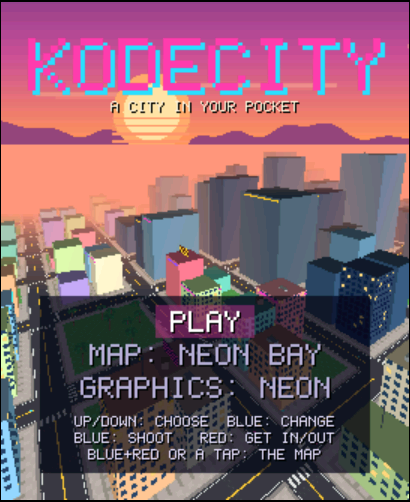
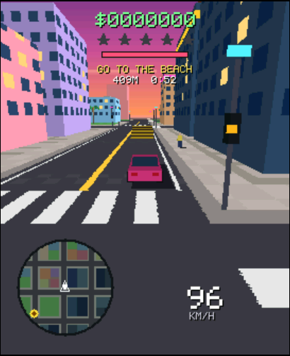
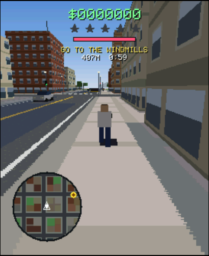
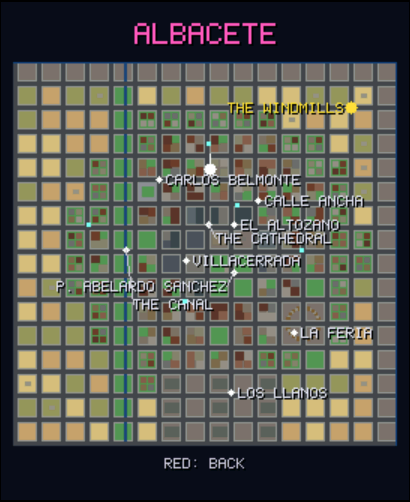

# KodeCity

An open-world 3D city in your pocket for the Kode Dot. Drive, walk, shoot, jump ramps, run from the police and its helicopter, and take timed jobs across town. Everything is drawn in software on the ESP32-P4, with no GPU, at about 25 to 30 frames a second.

   

## How to play

Hold the Kode Dot upright: the pad under the left thumb, the two round buttons under the right one.

| Button | On foot | In a car |
|---|---|---|
| Pad up / down | walk / step back | throttle / brake and reverse |
| Pad left / right | turn | steer (it drifts at speed) |
| Top (blue) | shoot; hold for bursts | shoot ahead |
| Bottom (red), a tap | get into the nearest car | get out (below about 20 km/h) |
| Top + bottom, or a tap on the glass | the map | the map |

Holding the bottom button returns to kodeOS, as in every app; the game only ever uses taps of it.

- **Jobs:** the top of the glass says where to go, how far it is and how long you have. A yellow beam marks the place, and the minimap and the map show it too. The sooner you get there, the more you are paid.
- **Police:** shooting, running people over and stealing cars earn stars. Every star brings one more patrol car, up to four, and three or more bring a helicopter with a searchlight. Stand still with a patrol car on top of you and you are arrested; stay away from them and the stars fade.
- **Ramps:** five yellow and black ramps across the city (cyan dots on the map). The first one is on the avenue where you start: get in the car and drive straight. A jump plays in slow motion and pays for every second in the air.
- **Radio:** in a car, Radio Neon 88.1 plays an original synthwave loop. Every sound is synthesised by the game; there are no samples.
- **Vibration:** shots, crashes, landings and blasts are felt in the hand.

## Cities and looks

On the title screen, up and down choose, the top button changes:

- **Map: Neon Bay** - an invented coastal city with a beach, palm trees and towers.
- **Map: Albacete** - a tongue-in-cheek Albacete: no sea, the canal, Parque Abelardo Sanchez, the fairground with its ring of stalls and a big wheel, the cathedral, El Altozano, the Carlos Belmonte stadium, the Los Llanos air base, and La Mancha around it with vineyards and windmills. The places are real names in made-up positions.
- **Graphics: Neon** - a fixed sunset, pastel colours, neon signs and lamps.
- **Graphics: Real** - daylight, sober colours, facades with floors, window frames and shop fronts, and the buildings' shadows on the street.

Changing the map or the look builds the city again, which takes about a second.

## How it is made

- `main/engine/` is the game in portable C: `r3d.c` a software rasteriser (the flat ground drawn one row at a time, polygons over it with a 16-bit inverse-depth buffer, distance fog), `world.c` the city generator and its drawing, `game.c` the player, cars, traffic, pedestrians, police, jobs, HUD and map, `sound.c` the synthesiser.
- `main/kodecity_ao.c` is the renderer: an Active Object that owns the glass with kscreen. The game draws 272 x 332 pixels into one of two kscreen pictures; the pixel accelerator scales it by 1.5 into a full-screen picture shown by one `kscreen_frame_create()` object, while the game draws the next frame into the other picture.
- `main/kodecity_main.c` starts the renderer and three tasks: the game on core 1, the audio stream (`kode_audio_stream_*`, 48 kHz) and the vibrations (`kode_haptic_*`).
- `tools/host/` builds the engine on a desktop: `compare.sh` replays scripted games in every city and look and compares every frame with a recorded baseline.
- `tools/bench.py` talks to the app's console without resetting the board: it presses buttons through the app's console functions and saves screenshots.

## Build

ESP-IDF v6.1, and SSH access to the Kode SDK:

```bash
. ~/.espressif/tools/activate_idf_v6.1.sh
idf.py build
```

Install `build/kodecity.bin` with `kcli.py install` from KodeOS's `tools/`.

## Licence

GNU GPL version 3 or later. The 5x7 font keeps the MIT credit of the glyphs it took from RetroESP32-P4.
